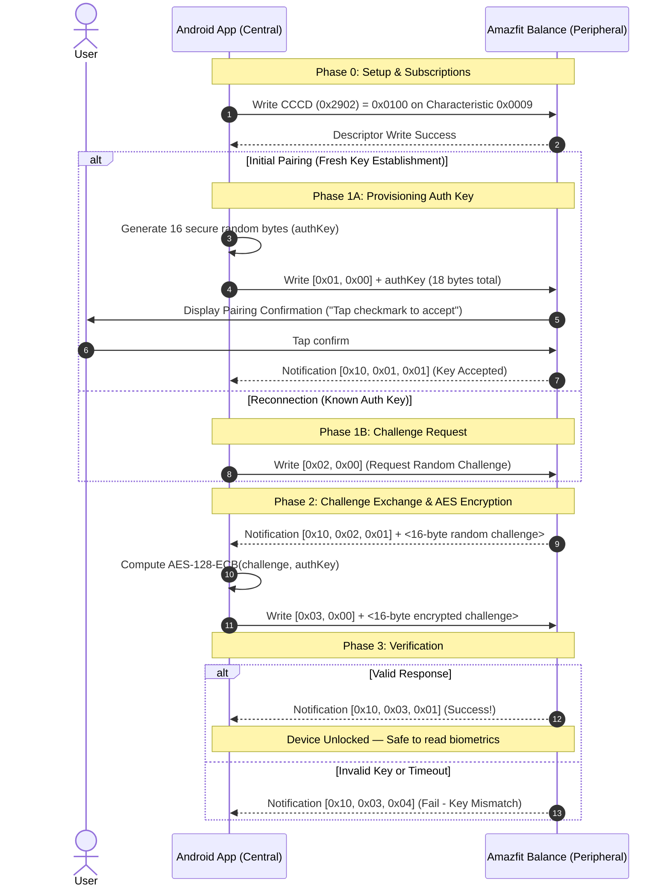

# Authentication & Pairing Cryptographic Handshake

The Zepp / Huami BLE stack implements a challenge-response authentication scheme using **AES-128 (ECB mode, NoPadding)**. All cryptographic communication takes place over Characteristic `00000009-0000-3512-2118-0009af100700` within Service `0000fee1-0000-1000-8000-00805f9b34fb`.

Until this handshake is successfully completed, the watch will ignore requests to subscribe to biometrics, chunk data, and notifications.

---

## 1. Authentication Handshake Flowchart



---

## 2. Opcode Reference

All commands written to Characteristic `0x0009` are prefixed by an Opcode and Sub-opcode:

| Opcode Byte 0 | Opcode Byte 1 | Description | Payload Length | Total Size |
| :--- | :--- | :--- | :--- | :--- |
| `0x01` | `0x00` | **Send Auth Key** (Initial pairing) | 16 bytes (`authKey`) | 18 bytes |
| `0x02` | `0x00` | **Request Random Challenge** | 0 bytes | 2 bytes |
| `0x02` | `0x00, 0x02, 0x01, 0x00` | **Request Challenge** (Modern Zepp OS variant) | 3 bytes | 5 bytes |
| `0x03` | `0x00` | **Send Encrypted Challenge** | 16 bytes (`encryptedChallenge`) | 18 bytes |

All notifications returned from Characteristic `0x0009` begin with header `0x10`:

| Response Byte 0 | Response Byte 1 (Opcode) | Response Byte 2 (Status) | Meaning |
| :--- | :--- | :--- | :--- |
| `0x10` | `0x01` | `0x01` | Key establishment accepted by user |
| `0x10` | `0x01` | `0x04` | Key establishment rejected / timed out |
| `0x10` | `0x02` | `0x01` | Challenge generated; followed by 16 bytes challenge |
| `0x10` | `0x03` | `0x01` | **Authentication Success!** Session unlocked. |
| `0x10` | `0x03` | `0x04` | Authentication failed (AES key mismatch) |

---

## 3. Cryptographic Implementation Details

### Encryption Parameters
* **Algorithm:** AES (Advanced Encryption Standard)
* **Key Size:** 128-bit (16 bytes)
* **Cipher Mode:** Electronic Codebook (ECB)
* **Padding:** `NoPadding` (Exact 16-byte block in, 16-byte block out)

### Java / Kotlin Example:
```kotlin
fun encryptChallenge(challenge: ByteArray, authKey: ByteArray): ByteArray {
    require(challenge.size == 16) { "Challenge must be 16 bytes" }
    require(authKey.size == 16) { "AuthKey must be 16 bytes" }
    
    val keySpec = SecretKeySpec(authKey, "AES")
    val cipher = Cipher.getInstance("AES/ECB/NoPadding")
    cipher.init(Cipher.ENCRYPT_MODE, keySpec)
    return cipher.doFinal(challenge)
}
```

### Python Example:
```python
from cryptography.hazmat.primitives.ciphers import Cipher, algorithms, modes

def encrypt_challenge(challenge_bytes: bytes, auth_key_bytes: bytes) -> bytes:
    cipher = Cipher(algorithms.AES(auth_key_bytes), modes.ECB())
    encryptor = cipher.encryptor()
    return encryptor.update(challenge_bytes) + encryptor.finalize()
```

---

## 4. How to Obtain the 16-Byte Auth Key

There are three primary methods to obtain or configure the Auth Key:

### Method 1: Fresh Direct Pairing (Recommended for Custom Apps)
If the watch is unbound or put into pairing mode:
1. Generate a random 16-byte cryptographically secure key:
   ```kotlin
   val authKey = ByteArray(16).apply { SecureRandom().nextBytes(this) }
   ```
2. Send Opcode `0x01 0x00 + authKey`.
3. The watch screen will vibrate and display a prompt asking to pair. Tap the checkmark on the Amazfit Balance screen.
4. Store `authKey` in Android EncryptedSharedPreferences for all future reconnects.

### Method 2: Extract from Zepp Android App (Rooted Android or Emulator)
If you already paired the watch using the official Zepp app:
1. Locate Zepp app internal database:
   ```bash
   /data/data/com.huami.watch.hmwatchmanager/databases/origin_db_*.db
   ```
2. Open with SQLite:
   ```sql
   SELECT mac_address, auth_key FROM DEVICE;
   ```
3. Strip any `0x` prefix to yield the 32-character hex string (16 bytes).

### Method 3: Cloud API Automated Key Retrieval
When logging into Zepp Cloud via the REST endpoints (see `docs/06-cloud-api-endpoints.md`), the `api-mifit.huami.com/users/{userId}/devices` endpoint returns JSON metadata containing the `auth_key` registered during setup.
