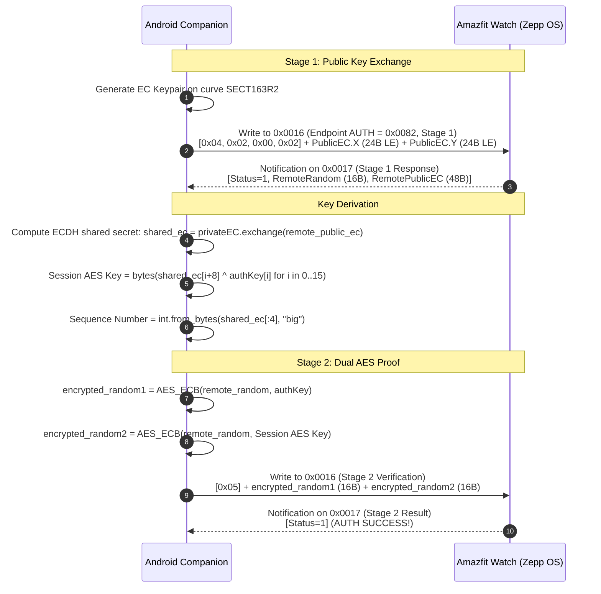

# Modern Zepp OS Chunked Encrypted Protocol (v2 / v3)

Modern Amazfit smartwatches (Amazfit Balance, GTR 4, GTS 4, Cheetah, T-Rex Ultra, Falcon) running **Zepp OS** implement a multiplexed, encrypted **Chunked Framing Transport**.

This layer enables bidirectional communication between the watch and phone for notifications, system commands, weather synchronization, HTTP proxy requests from watch mini-apps, and biometrics.

---

## 1. Transport Characteristics

* **Service UUID:** `0000fee0-0000-1000-8000-00805f9b34fb`
* **Write Endpoint (TX):** `00000016-0000-3512-2118-0009af100700` (App -> Watch)
* **Notify Endpoint (RX):** `00000017-0000-3512-2118-0009af100700` (Watch -> App)

---

## 2. Elliptic Curve Diffie-Hellman (ECDH) Handshake

In addition to legacy AES-128 pairing on `0x0009`, modern Zepp OS watches establish a dynamic session key over the Chunked Transport using ECDH on curve **`SECT163R2`**:



Once Stage 2 succeeds, all subsequent communication across endpoints is encrypted with `Session AES Key`.

---

## 3. Chunked Framing Header

Every packet transmitted over `0x0016` or received on `0x0017` is framed with a compact chunk header:

### First Chunk Header (11 bytes):
```
+---------+---------+---------+---------+---------+-------------------+---------------+
| Byte 0  | Byte 1  | Byte 2  | Byte 3  | Byte 4  | Bytes 5 - 8       | Bytes 9 - 10  |
+---------+---------+---------+---------+---------+-------------------+---------------+
| Magic   | Flags   | ExtFlag | Handle  | Count   | Full Length       | Endpoint ID   |
| (0x03)  | (bitmask| (0x00)  | (0-255) | (0)     | (uint32 LE)       | (uint16 LE)   |
+---------+---------+---------+---------+---------+-------------------+---------------+
```

### Continuation Chunk Header (4 to 5 bytes):
```
+---------+---------+---------+---------+
| Byte 0  | Byte 1  | Byte 2  | Byte 3  |
+---------+---------+---------+---------+
| Magic   | Flags   | Handle  | Count   |
| (0x03)  | (bitmask| (0-255) | (1..N)  |
+---------+---------+---------+---------+
```

### Header Flags Bitmask:
* `bit 0` (`0x01`): **`FIRST_CHUNK`** (Indicates presence of `Full Length` and `Endpoint ID`).
* `bit 1` (`0x02`): **`LAST_CHUNK`** (Indicates end of payload reassembly).
* `bit 2` (`0x04`): **`NEEDS_ACK`** (Watch requires a 5-byte ACK reply: `[0x04, 0x00, handle, 0x01, count]`).
* `bit 3` (`0x08`): **`ENCRYPTED`** (Payload is AES encrypted using `Message Key`).

---

## 4. Encryption & Message Key Derivation

When `ENCRYPTED` flag (`0x08`) is set:
1. **Dynamic Message Key:** Computed on each transaction by XORing the session key with the transaction handle:
   ```python
   message_key = bytes([session_key[i] ^ handle for i in range(16)])
   ```
2. **Payload Envelope:** Before encryption:
   ```
   [Raw Payload] + [SequenceNumber (4 bytes LE)] + [CRC32 Checksum (4 bytes LE)] + [Padding]
   ```
3. Cipher: **`AES/ECB/NoPadding`** padded to the nearest 16-byte boundary.

---

## 5. Chunked Endpoint Catalog (`ChunkedEndpoint`)

| Endpoint ID | Hex | Name | Purpose |
| :--- | :--- | :--- | :--- |
| `0` | `0x0000` | `SERVICES` | Service registry |
| `1` | `0x0001` | `HTTP` | HTTP proxy requests from Zepp OS mini-apps to phone |
| `3` | `0x0003` | `WIFI` | Watch Wi-Fi provisioning credentials |
| `7` | `0x0007` | `CALENDAR` | Event calendar synchronization |
| `10`| `0x000A` | `CONFIG` | Watch settings and toggles |
| `14`| `0x000E` | `WEATHER` | Daily and hourly weather forecast push |
| `15`| `0x000F` | `ALARMS` | Alarm clocks and wake timers |
| `21`| `0x0015` | `CONNECT` | Link ping (`0x03`) and MTU queries (`0x01`) |
| `22`| `0x0016` | `STEPS` | Modern realtime steps & step target queries |
| `25`| `0x0019` | `WORKOUT` | Active workout status, pause/resume, laps |
| `26`| `0x001A` | `FIND_DEVICE` | Find my phone / ring watch trigger |
| `27`| `0x001B` | `MUSIC` | Media player metadata and playback controls |
| `29`| `0x001D` | `HEARTRATE` | Realtime PPG continuous sampling mode |
| `30`| `0x001E` | `NOTIFICATIONS`| Incoming call and app notification push |
| `41`| `0x0029` | `BATTERY` | Battery state queries |
| `50`| `0x0032` | `SLEEP_DATA` | Sleep stage queries and configuration |
| `58`| `0x003A` | `LOGS` | Diagnostic log retrieval |
| `130`| `0x0082`| `AUTH` | ECDH session key exchange (Stage 1 & 2) |
| `160`| `0x00A0`| `JS` | Zepp OS JavaScript runtime sidecar bridge |
